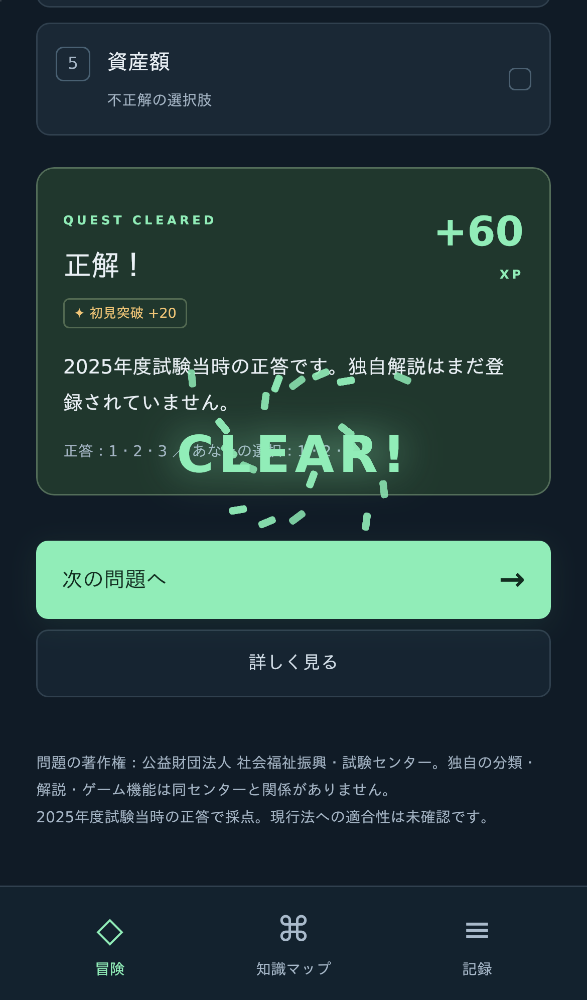
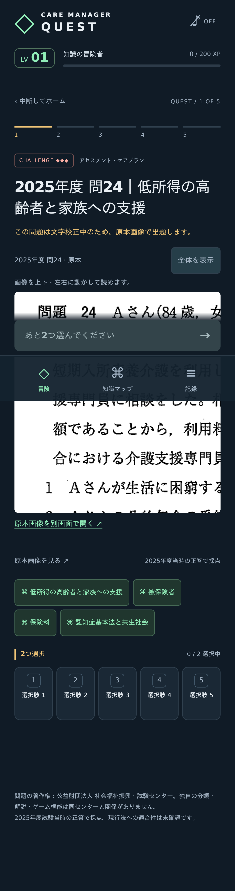

# 公式過去問への切り替えの検証

確認日：2026-10-10。

| 検証 | 結果 |
| --- | --- |
| TypeScript strict型チェック | 成功 |
| Vitest | 18テスト成功 |
| Vite本番ビルド | 成功 |
| Chromium・iPhone 13相当 | 6 E2E成功 |
| WebKit・iPhone 13相当 | 6 E2E成功 |
| 25問×全32選択組合せ | 完全一致採点を800組合せで確認 |
| 原本画像 | 全25問の番号・5選択肢を目視、SHA-256をテストで照合 |
| 公表正答 | 東京都の正答番号画像と全25問一致 |

E2Eでは5セッションを実際に操作し、公式25問を一巡しました。各問題の原本画像を開き、IDと画像URLの対応・画像の読み込み・正答を確認。旧問題が混じらないことも確認しています。

その他、5問リザルト、誤答、詳しく見る→知識マップの論点→元の解説、理解記録、途中の再読み込み、JSON出力／読み込みプレビュー／置換、不正JSONの拒否、外部URL記録、破損データ保護、schema 1の移行・バックアップ・XP維持を検証しました。分類と難度を変更しても保存履歴・XPが変わらないことを単体テストで確認しています。

## 画面

日本語フォントを備えた実際のWebKit画面を確認しました。判定直後に結果へ移動し、短い演出が操作を遮らないこと、テキスト問題と画像出題のどちらでも番号選択できることを確認しています。

## 実行環境と限界

開発環境ではブラウザの依存ライブラリと日本語フォントを作業領域に展開してChromium/WebKitを起動。CIはUbuntu 24.04でPlaywrightのinstall --with-depsを使用します。実機iPhoneのSafari・音声・指操作は未確認です。

校正の確定状況、独自解説、現行法適合性は[確認台帳](question-verification.md)とIssue #9〜#11で別管理。テスト成功を法令・専門家レビュー完了とは扱いません。GitHub Actionsの最終実行はPRのChecksで確認できます。
