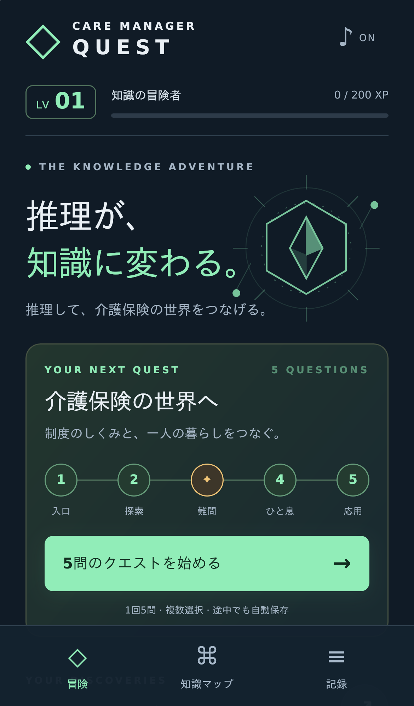
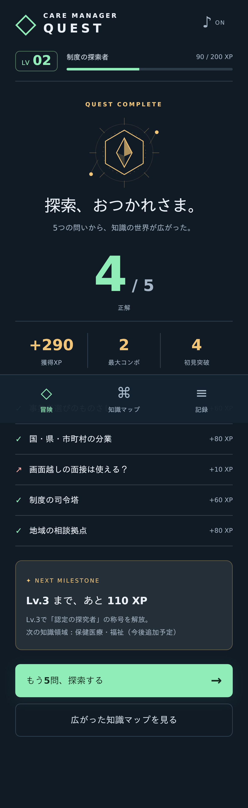

# MVPの検証

確認日：2026-10-10。

| 検証 | 結果 |
| --- | --- |
| TypeScript strict型チェック | 成功 |
| Vitest：問題データ契約・出題・XP・重複解答防止・保存検証 | 13テスト成功 |
| Vite本番ビルド | 成功 |
| Chromium：iPhone 13相当の画面・タッチ設定 | 4 E2E成功 |
| WebKit：iPhone 13相当の画面・タッチ設定 | 4 E2E成功 |

E2Eは5問完走、途中の誤答、深掘りと元の位置への復帰、リザルト、概念理解記録、複数選択の上限、途中再読み込み、JSON出力・入力プレビュー・置換、不正JSONの拒否、外部URL記録、破損データの保護とリセットを確認します。操作中のJavaScript例外と横方向のはみ出しも確認しました。

## 画面確認

日本語フォントを備えた環境で実際のWebKit画面を確認しました。開始ボタンを縦画面内に収め、解答時のエフェクトが次の操作を遮らない構造にしています。

## 実行環境と残る確認

この開発環境ではブラウザの必要ライブラリと日本語フォントを作業領域に展開しました。実際にChromium/WebKitを起動して検証しています。CIはUbuntu 24.04でPlaywrightの `install --with-deps chromium webkit` を使い、標準の依存関係を導入します。

iPhone実機のSafari・効果音・実際の指操作は未確認です。WebKitによるモバイル相当の確認は、実機確認を置き換えるものではありません。問題の一次資料との照合は実施しましたが、専門家による最終レビューは未実施です。GitHub Actionsの実行結果はPRのChecksで確認できます。
